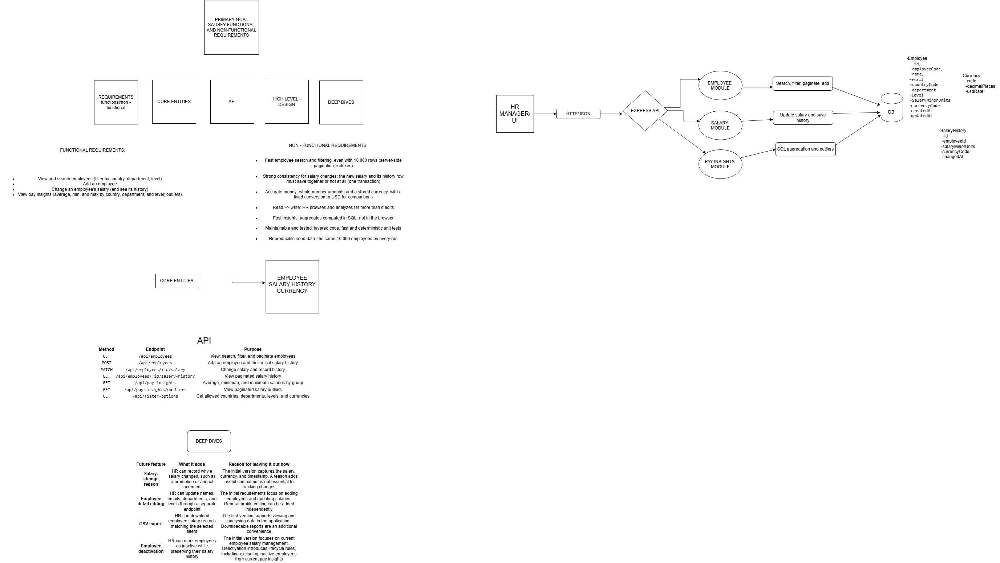

# Architecture

## Salary Management System Diagram

### Diagram summary

The diagram defines the system's primary goal, functional and non-functional requirements, high-level design, core entities, API surface, and future scope:

**Functional requirements**
- View and search employees (filter by country, department, level)
- Add an employee
- Change an employee's salary (and see its history)
- View pay insights (average, min, max by country, department, and level; outliers)

**Non-functional requirements**
- Fast search and filtering across 10,000 rows (server-side pagination, indexes)
- Strong consistency for salary changes (new salary and its history row must save together or not at all — one transaction)
- Accurate money: whole-number amounts and a stored currency, with fixed conversion to USD for comparisons
- Read >> write: HR browses and analyses far more than it edits
- Fast insights: aggregates computed in SQL, not in the browser
- Maintainable and tested: layered code, fast and deterministic unit tests
- Reproducible seed data: the same 10,000 employees on every run

**Core entities**: Employee, SalaryHistory, Currency

**High-level design**: HR Manager/UI → HTTP/JSON → Express API → Employee Module / Salary Module / Pay Insights Module → DB

**Database schema** (from diagram):
- Employee: id, employeeCode, name, email, countryCode, department, level, salaryMinorUnits, currencyCode, createdAt, updatedAt
- SalaryHistory: id, employeeId, salaryMinorUnits, currencyCode, changedAt
- Currency: code, decimalPlaces, usdRate

**API endpoints** (from diagram):

| Method | Endpoint | Purpose |
|--------|----------|---------|
| GET | /api/employees | View, search, filter, and paginate employees |
| POST | /api/employees | Add an employee and their initial salary history |
| PATCH | /api/employees/:id/salary | Change salary and record history |
| GET | /api/employees/:id/salary-history | View paginated salary history |
| GET | /api/pay-insights | Average, minimum, and maximum salaries by group |
| GET | /api/pay-insights/outliers | View paginated salary outliers |
| GET | /api/filter-options | Get allowed countries, departments, levels, and currencies |

**Deferred features** (from diagram's Deep Dives):
- Salary-change reason
- Employee detail editing
- CSV export
- Employee deactivation
