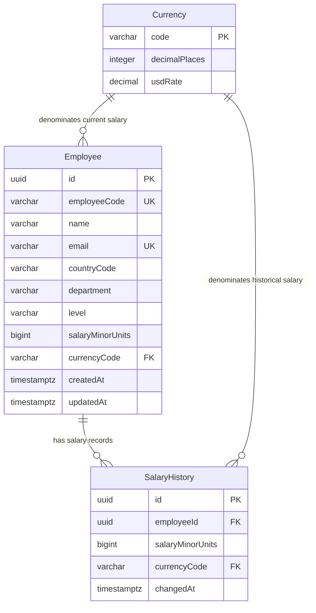

# ACME Salary Management — Database Schema

PostgreSQL + Prisma, with three tables for current salaries, salary history, and currency rules.

## Table relationships

**PK** = primary key · **FK** = foreign key · **UK** = unique key

## What each table does

| Table | Purpose | Key fields |
|---|---|---|
| **Currency** | Defines supported currencies and fixed USD conversion rates | `code`, `decimalPlaces`, `usdRate` |
| **Employee** | Stores employee details and current annual gross salary | Unique `employeeCode` and `email`; `salaryMinorUnits`, `currencyCode` |
| **SalaryHistory** | Records the initial salary and subsequent changes | `employeeId`, `salaryMinorUnits`, `currencyCode`, `changedAt` |

One employee can have many history entries. Each employee and history entry references one currency.

## Money and salary updates

- **Exact amounts:** salaries use integer minor units. `5000000` INR means **₹50,000** because INR has two decimal places; JPY has none.
- **Atomic changes:** a transaction locks the employee row, updates the current salary, and inserts history. Both writes succeed or roll back together.
- **No duplicate history:** submitting the same amount and currency adds no entry.
- **History preservation:** earlier entries remain unchanged through the application workflow; database-enforced immutability requires additional controls.

## Data protection

- Employee codes and emails must be unique.
- Salaries must be between `1` and `9007199254740991` to remain safe JavaScript integers.
- Foreign keys prevent references to missing employees or currencies.
- The specified `ON DELETE RESTRICT` rules block deletion of referenced records.

## Indexes

| Type | Fields | Purpose |
|---|---|---|
| **B-tree** | Primary keys, employee code, email | Identity, uniqueness, and exact lookups |
| **B-tree** | Country, department, level | Filtering |
| **Composite B-tree** | `employeeId`, `changedAt`, `id` | Stable, newest-first salary history |
| **GIN trigram** | Name, email, employee code | Substring searches such as `ILIKE '%deek%'` |

B-trees keep values ordered. GIN trigram indexes map three-character text pieces to matching rows. Indexes cost storage and write overhead; PostgreSQL decides when to use them.

*Schema details follow the supplied design; applied migrations are authoritative for database constraints and indexes.*
